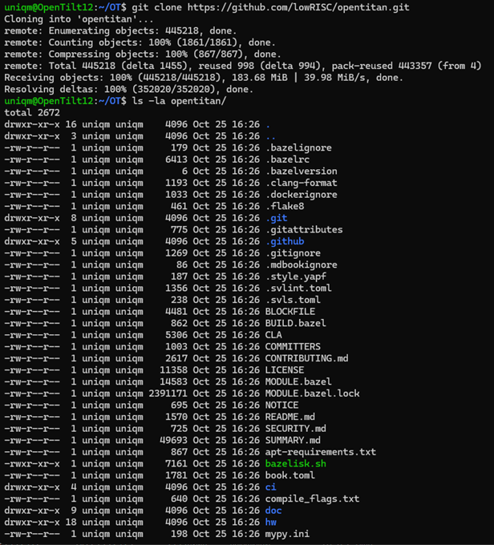
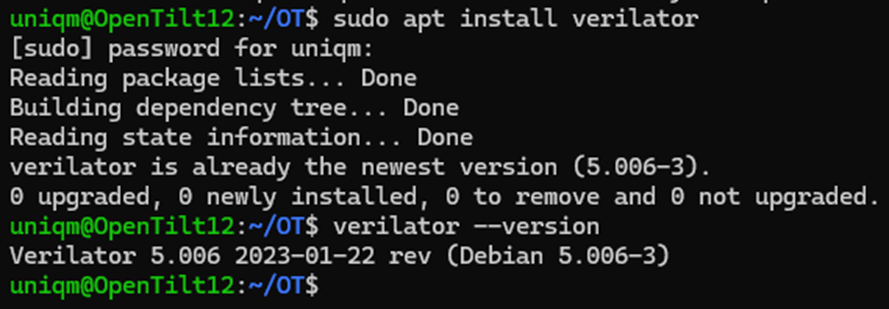
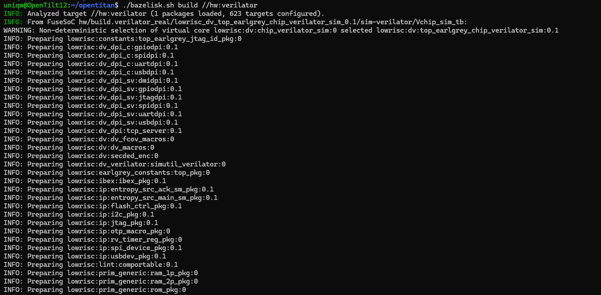
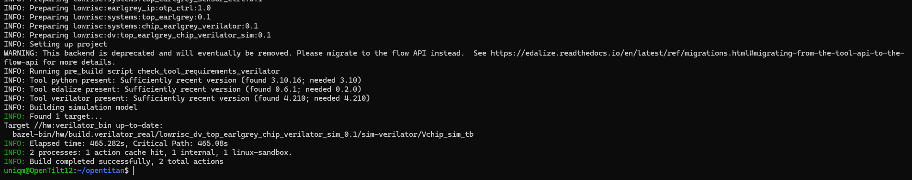
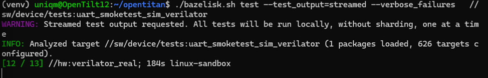
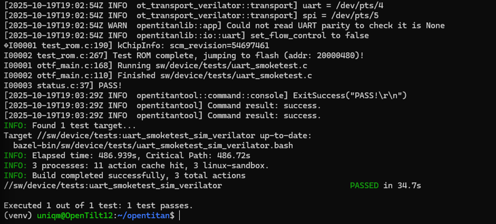

# Настройка программной среды

Суть данного этапа заключается в настройке программной среды для сборки и тестирования проекта OpenTitan, а также в выполнении базового функционального smoke-теста симулируемого кристалла с использованием симулятора Verilator и инструментария Bazel.

Для разработки и тестирования используются:
- система сборки: Bazel;
- язык описания аппаратуры: SystemVerilog;
- симулятор: Verilator.

### 1. Подготовка окружения

Клонирование репозитория происходит при помощи следующей команды:

```bash
git clone https://github.com/lowRISC/opentitan.git
```

Результат работы команды можем увидеть на рисунке ниже:



### 2. Установка и настройка симулятора Verilator

Для моделирования аппаратной части использовался Verilator – симулятор аппаратного описания на языке Verilog, который преобразует синтезируемый Verilog в код на C++.

---
**Проблема:**

На начальных этапах была произведена установка Verilog версии `v5.006`.

Установка производилась через стандартный менеджер пакетов Debian при помощи команды:

```bash
sudo apt install verilator
```



В установки системы были также добавлены зависимости, необходимые для компиляции DPI-модулей и хостовых библиотек OpenTitan:
- clang;
- llvm;
- pkg-config;
- libftdi1;
- libusb-1.0;
- libtinfo5.

Однако в ходе работы была обнаружена ошибка: данная версия симулятора **не совместима** с OpenTitan. Поэтому было принято решение установить вручную версию `v4.228`.

---

Устанавливаем gcc-11:

```bash
sudo apt install gcc-11 g++-11
```

Клонируем Verilator и переключаемся на нужный тег:

```bash
export VERILATOR_VERSION=4.228
git clone https://github.com/verilator/verilator.git
cd verilator && git checkout v$VERILATOR_VERSION
```

Конфигурируем и собираем:

```bash
autoconf
CC=gcc-11 CXX=g++-11 ./configure --prefix=/tools/verilator/$VERILATOR_VERSION
CC=gcc-11 CXX=g++-11 make
sudo CC=gcc-11 CXX=g++-11 make install
```

Запуск осуществляется при помощи команды:

```bash
./bazelisk.sh build //hw:verilator
```




### 3. Сборка и запуск теста

Для сборки OpenTitan используется Bazel, однако в репозитории вместо него применяется оболочка bazelisk, которая автоматически подбирает совместимую версию Bazel.

Запуск тестов осуществляется через следующий скрипт:

```bash
./bazelisk.sh test --test_output=streamed //sw/device/tests:uart_smoketest_sim_verilator
```

Цель теста: проверить базовую работоспособность системы на кристалле (SoC) Earl Grey в симуляторе Verilator.



Успешное выполнение теста свидетельствует о том, что:
- ядро Ibex запущено и исполнило тестовую прошивку;
- базовые IP-модули (память, шина TL-UL, UART) функционируют корректно;
- симуляционная среда Verilator настроена правильно.

Результат отработки тестов представлен на рисунке ниже:


