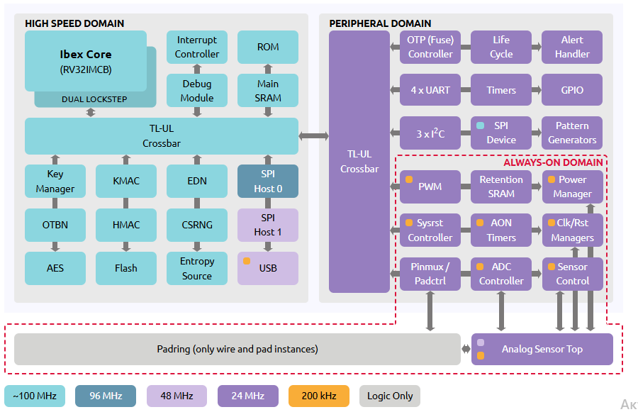

# Доработка Zephyr для запуска Opentitan

### 1. Введение
Доработка проводилась для версии Zephyr commit 545c2870e9358d52e319b9ae301845e053376fe1
Исследовалось тестовое приложение Hello world (samples/hello_world)

### 2. Описание проблемы
При запуске образа Zephyr в ОpenTitan на симуляторе было обнаружено, что управление Zephyr передается, по адресу 0х20000400, но при этом сообщение "Hello world" в консоль не выводится. Более детальный анализ показал, что происходит это по следующей причине. После старта Zephyr выполняет некоторые процедуры инициализации системы, в частности настройку системного таймера. Во время настройки таймера происходит обращение к периферии по несуществующему адресу. В результате чего процессор генерирует исключение со значениями контрольных регистров:
```
mtval = 0x40100210
mepc =  0x200019c4
```
То есть происходит обращение по адресу 0х40100210, которого нет в адресном пространстве OpenTitan.

В результате исключения система переходит к выполнению функции arch_system_halt(), и уже не выходит из этого состояния. Поэтому со стороны это выглядит как зависание. arch_system_halt() находится в zephyr/kernel/fatal.c
```
FUNC_NORETURN __weak void arch_system_halt(unsigned int reason)
{
        ARG_UNUSED(reason);

        /* TODO: What's the best way to totally halt the system if SMP
         * is enabled?
         */

        (void)arch_irq_lock();
        for (;;) {
                /* Spin endlessly */
        }
}

```
Ситуация, которая привела к исключению, происходит при выполнении функции soc_early_init_hook(), которая находится в zephyr/soc/lowrisc/opentitan/soc.c:
```
void soc_early_init_hook(void)
{
        /* Enable the watchdog reset (bit 1). */
        sys_write32(2u, PWRMGR_BASE + PWRMGR_RESET_EN_REG_OFFSET);
        /* Write CFG_CDC_SYNC to commit change. */
        sys_write32(1u, PWRMGR_BASE + PWRMGR_CFG_CDC_SYNC_REG_OFFSET);
        /* Poll CFG_CDC_SYNC register until it reads 0. */
        while (sys_read32(PWRMGR_BASE + PWRMGR_CFG_CDC_SYNC_REG_OFFSET)) {
        }

        /* Initialize the Machine Timer, so it behaves as a regular one. */
        sys_write32(1u, RV_TIMER_BASE + RV_TIMER_CTRL_REG_OFFSET);
        /* Enable timer interrupts. */
        sys_write32(1u, RV_TIMER_BASE + RV_TIMER_INTR_ENABLE_REG_OFFSET);
}

```

### 3. Решение проблемы
Анализ функции soc_early_init_hook() показывает, что исключение происходит при выполнении вот этого фрагмента кода:
```
        /* Enable timer interrupts. */
        sys_write32(1u, RV_TIMER_BASE + RV_TIMER_INTR_ENABLE_REG_OFFSET);

```

В файле soc.c есть набор констант:
```
/* Ibex timer registers. */
#define RV_TIMER_BASE (DT_REG_ADDR(DT_NODELABEL(mtimer)))
#define RV_TIMER_CTRL_REG_OFFSET        0x004
#define RV_TIMER_INTR_ENABLE_REG_OFFSET 0x100
#define RV_TIMER_CFG0_REG_OFFSET        0x10c
#define RV_TIMER_CFG0_PRESCALE_MASK     0xfff
#define RV_TIMER_CFG0_PRESCALE_OFFSET   0
#define RV_TIMER_CFG0_STEP_MASK         0xff
#define RV_TIMER_CFG0_STEP_OFFSET       16
#define RV_TIMER_LOWER0_OFFSET          0x110
#define RV_TIMER_COMPARE_LOWER0_OFFSET  0x118

```
Как было указано выше, в результате работы функции `sys_write` происходит запись по адресу 0х40100210, что неправильно. Функция `sys_write` формирует адрес для записи как сумму:
```
RV_TIMER_BASE + RV_TIMER_INTR_ENABLE_REG_OFFSET
```
Второе слагаемое точно правильное. Оно задано константой и константа правильная (почему будет рассказано ниже).
А вот первое слагаемое формируется в результате выполнения макроса и видимо формируется неправильно.
Дальнейший анализ исходников показал, что `mtimer` для вычисления `RV_TIMER_BASE` берется из файла devicetree для Opentitan (zephyr/dts/riscv/lowrisc/opentitan_earlgrey.dtsi):
```
                mtimer: timer@40100110 {
                        compatible = "riscv,machine-timer";
                        reg = <0x40100110 0x8 0x40100118 0x8>;
                        reg-names = "mtime", "mtimecmp";
                        interrupts-extended = <&hlic 7>;
                };

```

'timer@40100110' - это базовый адрес адресного пространства, что неправильно. Базовый адрес таймера - 0х40100000. Именно поэтому происходит обращение по несуществующему адресу - 0х40100110 + 0х100 - такого адреса нет в адресном пространстве таймера.

opentitan_earlgrey.dtsi был отредактирован следующим образом:
```
                mtimer: timer@40100000 {
                        compatible = "riscv,machine-timer";
                        reg = <0x40100000 0x4 0x40100110 0x8 0x40100118 0x8>;
                        reg-names = "alert_test", "mtime", "mtimecmp";
                        interrupts-extended = <&hlic 7>;
                };

```
После этого исключение исчезло, то есть все обращения системы стали проходит по существующим адресам. И в консоли стало появляться сообщение "Hello world", как и должно быть.

Однако, было ещё замечено, что таймер после исправления работает, но настраивается не совсем корректно. А так как мы работаем с операционной системой, а не с отдельным приложением, настройка таймера критически важна. 

У системного таймера есть два регистра:
```
mtime - текущее время
mtimecp - регистр сравнения
```
При равенстве текущего времени и регистра сравнения генерируется прерывание. И в текущей конфигурации былы такие настройки, при которых `mtimecp` устанавливался меньше `mtime`, и сразу возникало прерывание. Первоначальная настройка системного таймера проводится функцией sys_clock_driver_init(), из файла zephyr/drivers/timer/riscv_machine_timer.c:
```
static int sys_clock_driver_init(void)
{
        IRQ_CONNECT(TIMER_IRQN, 0, timer_isr, NULL, 0);
        last_ticks = mtime() / CYC_PER_TICK;
        last_count = last_ticks * CYC_PER_TICK;
        set_mtimecmp(last_count + CYC_PER_TICK);
        irq_enable(TIMER_IRQN);
        return 0;
}

```
Как видно, mtimecmp устанавливает функция set_mtimecmp(), путем записи суммы текущего значения счетчика last_count и константы CYC_PER_TICK.

То есть получается, что CYC_PER_TICK - слишком маленькое значение.

Анализ исходников показал, что для того, чтобы поменять CYC_PER_TICK, нужно отредактировать файл zephyr/soc/lowrisc/opentitan/Kconfig.defconfig. В этом файле по умолчанию было задано значение:
```
config SYS_CLOCK_HW_CYCLES_PER_SEC
        default 1000000

```
То есть частота системного таймера 1МГц. А в моем случае частота была 5МГц. Соответственно файл был отредактирован:
```
if SOC_OPENTITAN

config SYS_CLOCK_HW_CYCLES_PER_SEC
        default 5000000

config SYS_CLOCK_TICKS_PER_SEC
        default 1000

config RISCV_SOC_INTERRUPT_INIT
        default y

config 2ND_LVL_ISR_TBL_OFFSET
        default 32

config 2ND_LVL_INTR_00_OFFSET
        default 11

config NUM_IRQS
        default 256

# The OpenTitan SoC requires a manifest in front of the
# application binary.
config ROM_START_OFFSET
        default 0x400

endif # SOC_OPENTITAN

```
Кроме редактирования текущего значения в файл было добавлено новое:
```
config SYS_CLOCK_TICKS_PER_SEC
        default 1000

```
Это было сделано потому, что по умолчанию SYS_CLOCK_TICK_PER_SEC = 10000. При таком значении получались слишком маленькие кванты времени. Поэтому значение было уменьшено.

После вышеуказанных изменений система заработала корректно - в консоль выводится сообщение "Hello World", и таймер работает и генерирует периодические прерывания, как и положено в операционной системе.

Однако следует заметить, что исправление адресного пространства обязательно для всех систем. А вот настройки таймера - индивидуальные и могут меняться от системы к системе. Очевидно они зависят от рабочей частоты системного таймера и желаемого кванта времени.


### 4. Адресное пространство OpenTitan
Знание адресного пространства OpenTitan важно как для разработки собственных программ, так и для поиска неисправностей, показанных выше. Можно конечно посмотреть адресное пространство устройства на сайте проекта. Но здесь есть проблема - на сайте всегда показано адресное пространство последней версии, а работать иногда приходится и с другими версиями устройства. Поэтому самый надежный способ - посмотреть адресную карту в исходниках.
Блок-схема устройства выглядит следующим образом:



Все периферийные устройства доступны на одной из шин TL-UL - основной, голубого цвета в HIGH SPEED DOMAIN, и периферийной - пурпурного цвета в PERIPHERAL DOMAIN. На какой шине смотреть адрес - можно посмотреть на блок-схеме. Например, видно, что таймеры (Timers) находятся на периферийной шине.
На шинах задаются базовые адреса устройств и размеры из адресных пространств.

Чтобы посмотреть устройтва на основной шине, нужно открыть файл (в проекте OpenTitan) hw/top_earlgrey/ip/xbar_main/rtl/autogen/tl_main_pkg.sv Этот файл написан на языке System Verilog, но в принципе понять распределение адресов можно и без знания этого языка. Для периферийной шины нужно открыть файл hw/top_earlgrey/ip/xbar_peri/rtl/autogen/tl_peri_pkg.sv
Содержимое файлов похоже, поэтому здесь будет приведен фрагмент содержимого только tl_peri_pkg.sv (потому что там находится таймер):
```
  localparam logic [31:0] ADDR_SPACE_UART0                   = 32'h 40000000;
  localparam logic [31:0] ADDR_SPACE_UART1                   = 32'h 40010000;
  localparam logic [31:0] ADDR_SPACE_UART2                   = 32'h 40020000;
  localparam logic [31:0] ADDR_SPACE_UART3                   = 32'h 40030000;
  localparam logic [31:0] ADDR_SPACE_I2C0                    = 32'h 40080000;
  localparam logic [31:0] ADDR_SPACE_I2C1                    = 32'h 40090000;
  localparam logic [31:0] ADDR_SPACE_I2C2                    = 32'h 400a0000;
  localparam logic [31:0] ADDR_SPACE_PATTGEN                 = 32'h 400e0000;
  localparam logic [31:0] ADDR_SPACE_PWM_AON                 = 32'h 40450000;
  localparam logic [31:0] ADDR_SPACE_GPIO                    = 32'h 40040000;
  localparam logic [31:0] ADDR_SPACE_SPI_DEVICE              = 32'h 40050000;
  localparam logic [31:0] ADDR_SPACE_RV_TIMER                = 32'h 40100000;
  localparam logic [31:0] ADDR_SPACE_PWRMGR_AON              = 32'h 40400000;
  localparam logic [31:0] ADDR_SPACE_RSTMGR_AON              = 32'h 40410000;
  localparam logic [31:0] ADDR_SPACE_CLKMGR_AON              = 32'h 40420000;
  localparam logic [31:0] ADDR_SPACE_PINMUX_AON              = 32'h 40460000;
  localparam logic [31:0] ADDR_SPACE_OTP_CTRL__CORE          = 32'h 40130000;
  localparam logic [31:0] ADDR_SPACE_OTP_MACRO__PRIM         = 32'h 40138000;
  localparam logic [31:0] ADDR_SPACE_LC_CTRL__REGS           = 32'h 40140000;
  localparam logic [31:0] ADDR_SPACE_SENSOR_CTRL_AON         = 32'h 40490000;
  localparam logic [31:0] ADDR_SPACE_ALERT_HANDLER           = 32'h 40150000;
  localparam logic [31:0] ADDR_SPACE_SRAM_CTRL_RET_AON__REGS = 32'h 40500000;
  localparam logic [31:0] ADDR_SPACE_SRAM_CTRL_RET_AON__RAM  = 32'h 40600000;
  localparam logic [31:0] ADDR_SPACE_AON_TIMER_AON           = 32'h 40470000;
  localparam logic [31:0] ADDR_SPACE_SYSRST_CTRL_AON         = 32'h 40430000;
  localparam logic [31:0] ADDR_SPACE_ADC_CTRL_AON            = 32'h 40440000;
  localparam logic [31:0] ADDR_SPACE_AST                     = 32'h 40480000;

```
Как видно из этого файла, базовый адрес таймера:
```
  localparam logic [31:0] ADDR_SPACE_RV_TIMER                = 32'h 40100000;

```
32'h40100000 Здесь следует пояснить, что 32 в начале - это размерность числа, а 'h - это формат представления, в данном случае hex. То есть 32'h40100000 - это 0х40100000

Для просмотра адресного пространства отдельного устройства нужно зайти в папку с исходниками этого устройства. Для таймера, например, исходники находятся в папке hw/ip/rv_timer/rtl

Файлы регистровых карт для устройства в проекте OpenTitan стандартизированы. Нужно искать файл с именем *название_устройства*_reg_pkg.sv. В данном случае это будет rv_timer_reg_pkg.sv 

Смотрим регистровую карту для устройства (она не в начале, нужно немного пролистать файл):
```
  // Register offsets
  parameter logic [BlockAw-1:0] RV_TIMER_ALERT_TEST_OFFSET = 9'h 0;
  parameter logic [BlockAw-1:0] RV_TIMER_CTRL_OFFSET = 9'h 4;
  parameter logic [BlockAw-1:0] RV_TIMER_INTR_ENABLE0_OFFSET = 9'h 100;
  parameter logic [BlockAw-1:0] RV_TIMER_INTR_STATE0_OFFSET = 9'h 104;
  parameter logic [BlockAw-1:0] RV_TIMER_INTR_TEST0_OFFSET = 9'h 108;
  parameter logic [BlockAw-1:0] RV_TIMER_CFG0_OFFSET = 9'h 10c;
  parameter logic [BlockAw-1:0] RV_TIMER_TIMER_V_LOWER0_OFFSET = 9'h 110;
  parameter logic [BlockAw-1:0] RV_TIMER_TIMER_V_UPPER0_OFFSET = 9'h 114;
  parameter logic [BlockAw-1:0] RV_TIMER_COMPARE_LOWER0_0_OFFSET = 9'h 118;
  parameter logic [BlockAw-1:0] RV_TIMER_COMPARE_UPPER0_0_OFFSET = 9'h 11c;

```
И вот здесь приведены актуальные смещения для регистров, которые можно сравнивать со значениями в Zephyr.
