# Попытка запуска Zephyr локально

### 1. Установка зависимостей для Zephyr

Подготовка системных пакетов для `Zephyr` происходит при помощи следующей команды:

```bash
sudo apt install --yes \
git cmake ninja-build gperf ccache dfu-util \
device-tree-compiler wge python3-dev python3-pip \
python3-setuptools python3-tk python3-wheel xz-utils file\
make gcc g++ libmagic1
```

Выполнение команды показано на рисунке ниже:

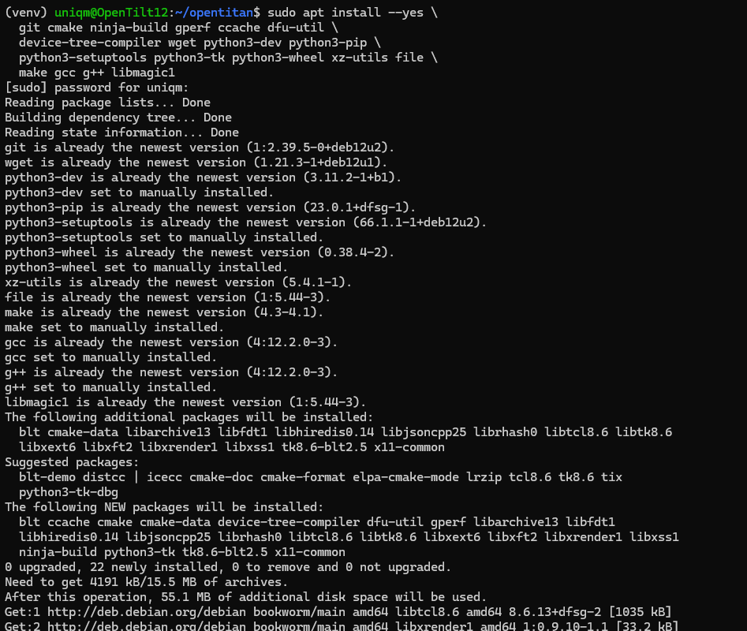

### 2. Установка `west`

Для установки пакета `west` использовалась следующая команда:

```bash
python3 -m pip install west
```

Выполнение команды показано на рисунке ниже:

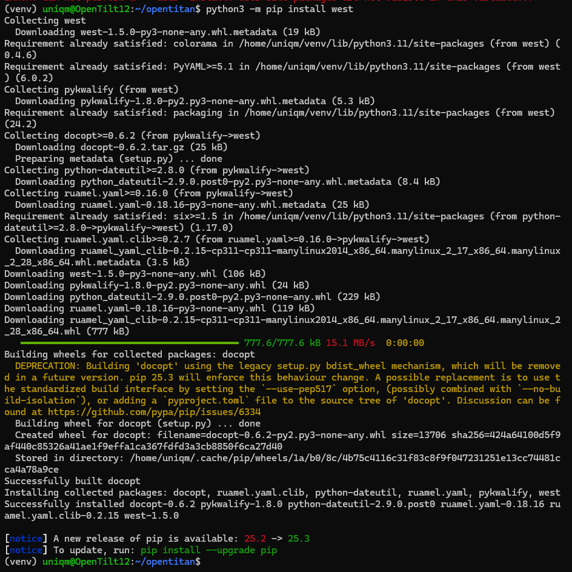
### 3. Инициализация и обновление Zephyr

Инициализация Zephyr происходит при помощи следующей команды:

```bash
west init zephyproject
```

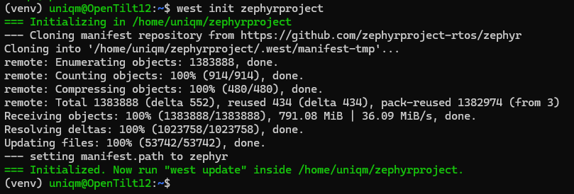

В результате работы команды клонируется манифест (`Initialized. Now run "west update"`).

Обновляем при помощи команды:

```bash
west update
```

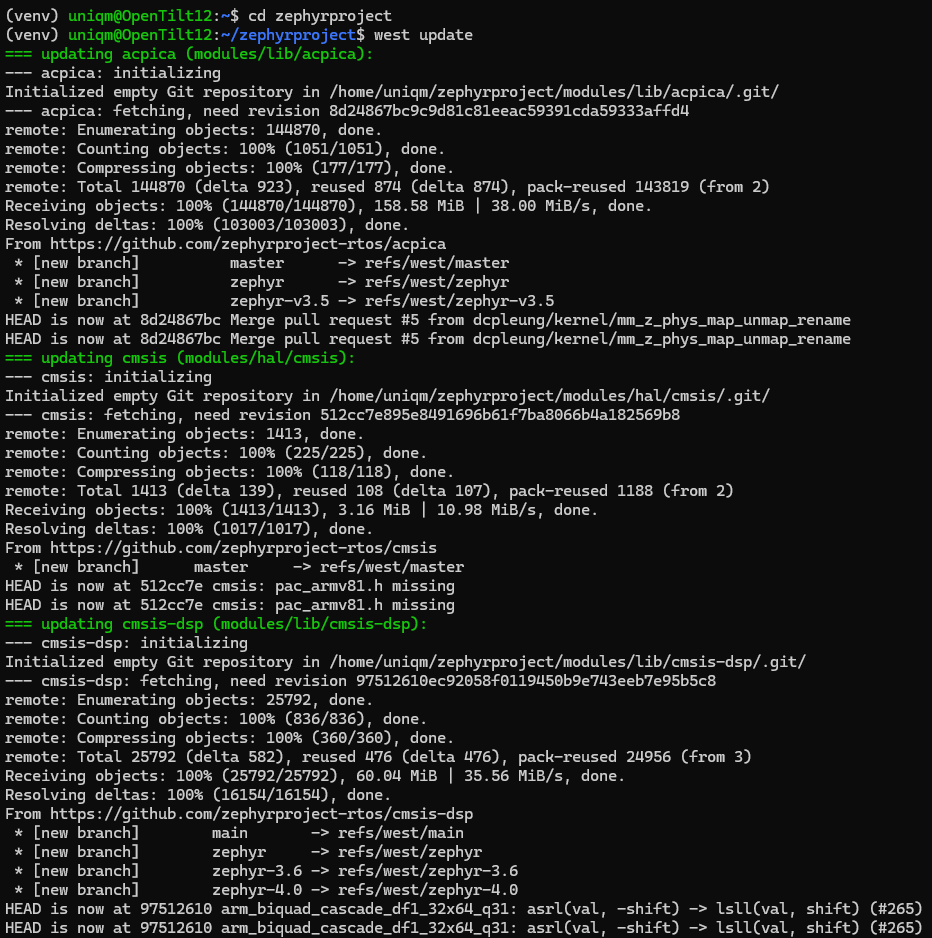
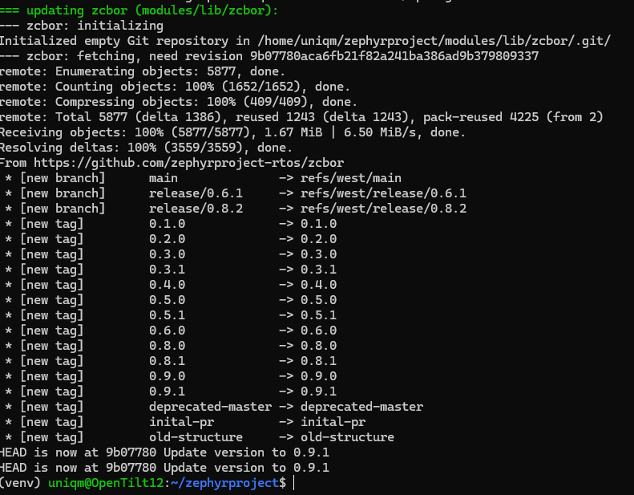

Добавляем Zephyr в Cmake-модули:

```bash
west zephyr-export
```

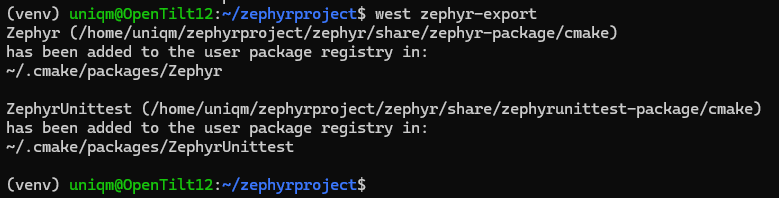

Теперь сам репозиторий лежит в `~/zephyrproject/zephyr`.

### 4. Установка Zephyr SDK

Пробуем скачать архив с актуальной версией `Zephyr SDK` при помощи команды:

```bash
wget https://github.com/zephyrproject-rtos/sdk-ng/releases/download/v1.0.0/zephyr-sdk-1.0.0_linux-x86_64_minimal.tar.xz
```

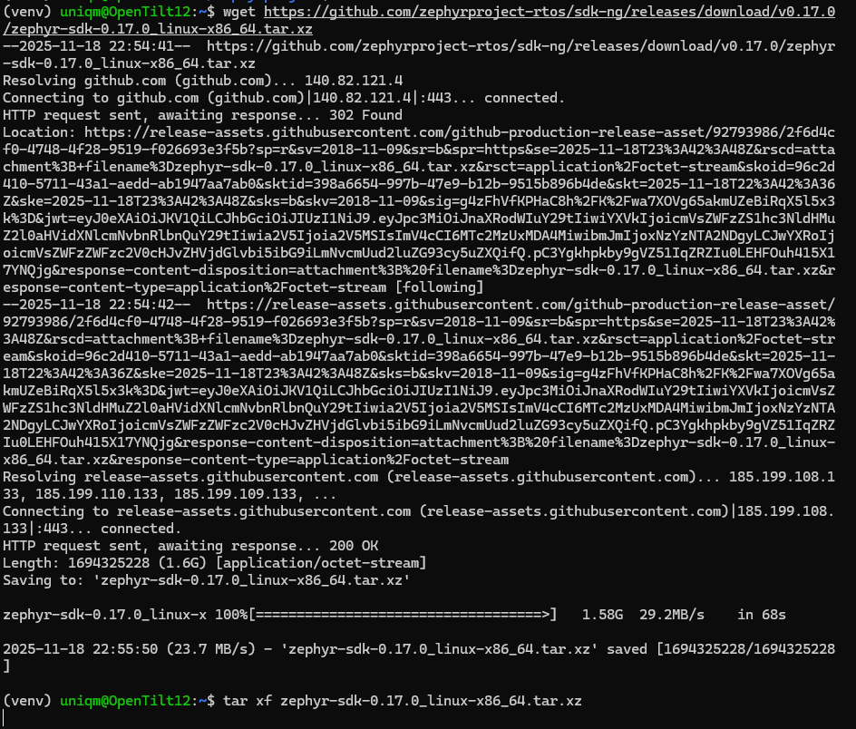

Распаковываем архив, переходим в папку и запускаем скрипт-установщик:

```bash
tar xf zephyr-sdk-1.0.0_linux-x86_64_minimal.tar.xz
cd zephyr-sdk-1.0.0/
./setup.sh
```

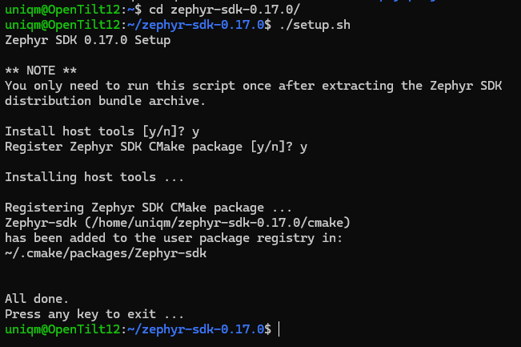

### 5. Сборка Zephyr `hello_world` для OpenTitan

Теперь собираем sample под плату `opentitan_earlgrey` (официальный Zephyr board для Earl Grey на Verilator) при помощи команды:

```bash
west build -b opentitan_earlgrey samples/hello_world --pristine
```

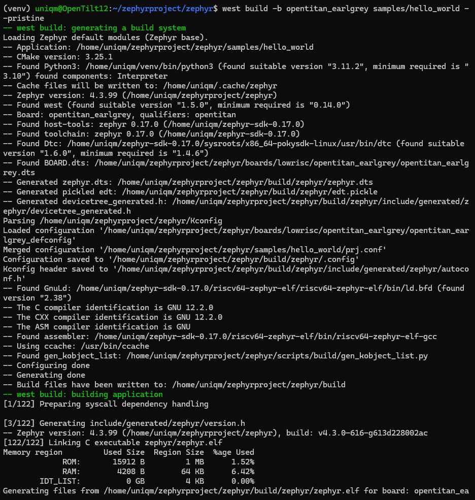

### 6. Подготовка образов OpenTitan (ROM и OTP)

Bazel собирает тестовый ROM и OTP-образы, после чего они используются при запуске симулятора вместе с прошивкой Zephyr.

Сборка тестового ROM `test_rom_sim_verilator` с помощью `bazelisk.sh`:

```bash
./bazelisk.sh build //sw/device/lib/testing/test_rom:test_rom_sim_verilator
```

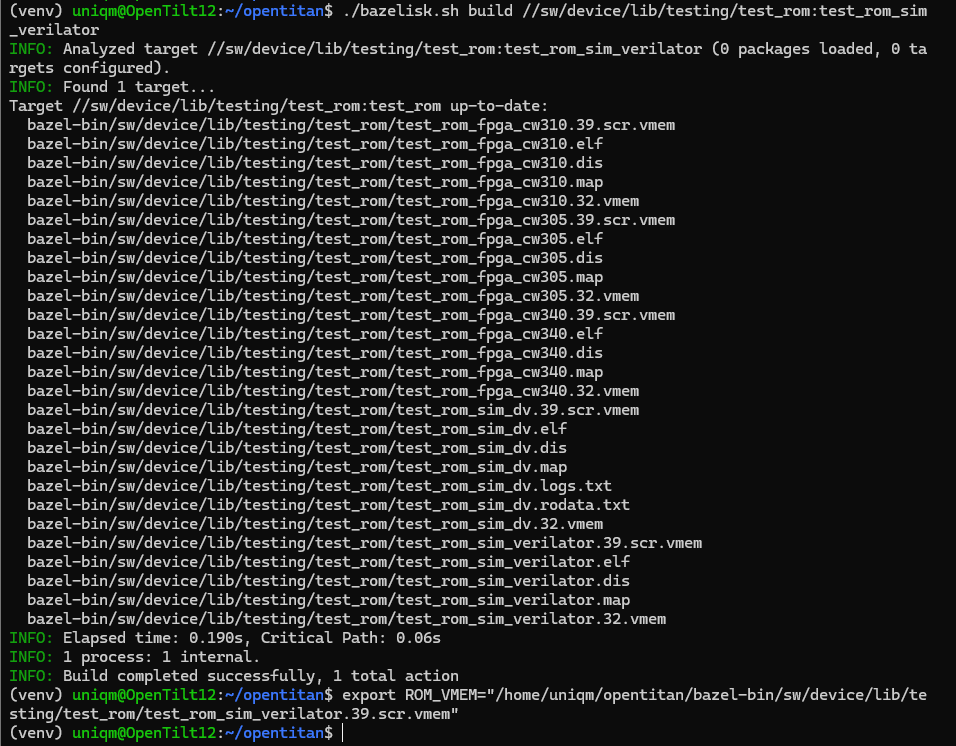

Сборка тестового OTP `img_rma` с помощью `bazelisk.sh`

```bash
./bazelisk.sh build //hw/top_earlgrey/data/otp:img_rma || \
./bazelisk.sh build //hw/ip/otp_ctrl/data:img_rma
```

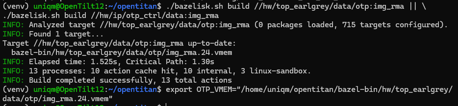

### 7. Запуск Zephyr на OpenTitan

Указываем путь до верилятора:

```bash
export VERILATOR_BIN=bazel-bin/hw/build.verilator_real/lowrisc_dv_top_earlgrey_chip_verilator_sim_0.1/sim_verilator/Vchip_sim_tb
```

Если его нет в opentitan/bazel-bin/.. - его нужно билдить снова (см. пункт 2: Подготовка рабочего окружения)

Запускаем Zephyr при помощи команды:

```bash
"$VERILATOR_BIN" --verbose-mem-load --meminit=rom0,"$ROM_VMEM" --meminit=otp,"$OTP_VMEM" --meminit=flash0,"$ZEPHYR_ELF"
```

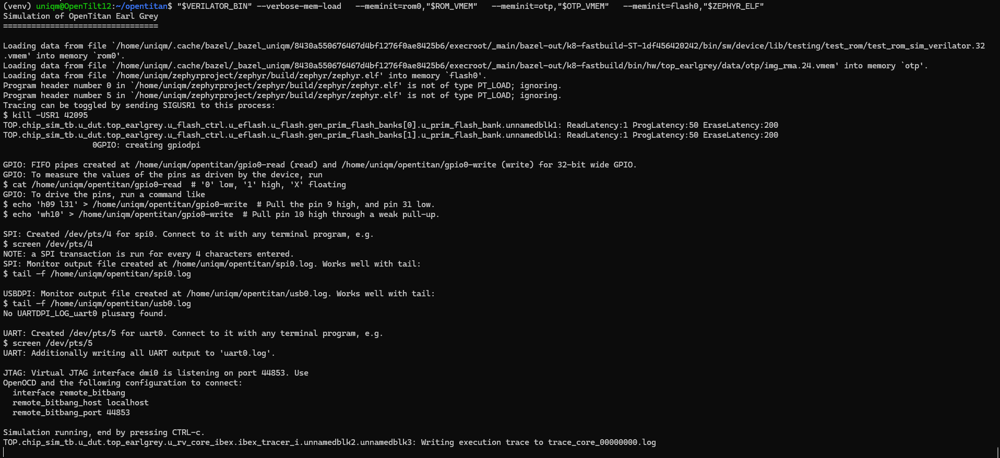

И на этом моменте все зависает. При детальном анализе `trace_core_00000000.log` делаем следующий вывод: ROM отрабатывает, прыгает по адресу `0x20000400` в Zephyr, а дальше Zephyr попадает в какую-то вечную петлю и уже ничего не печатает.

Исправить эту проблему на данный момент не удалось. Поэтому было принято решение протестировать запуск Zephyr уже не локально, а на контейнере.
