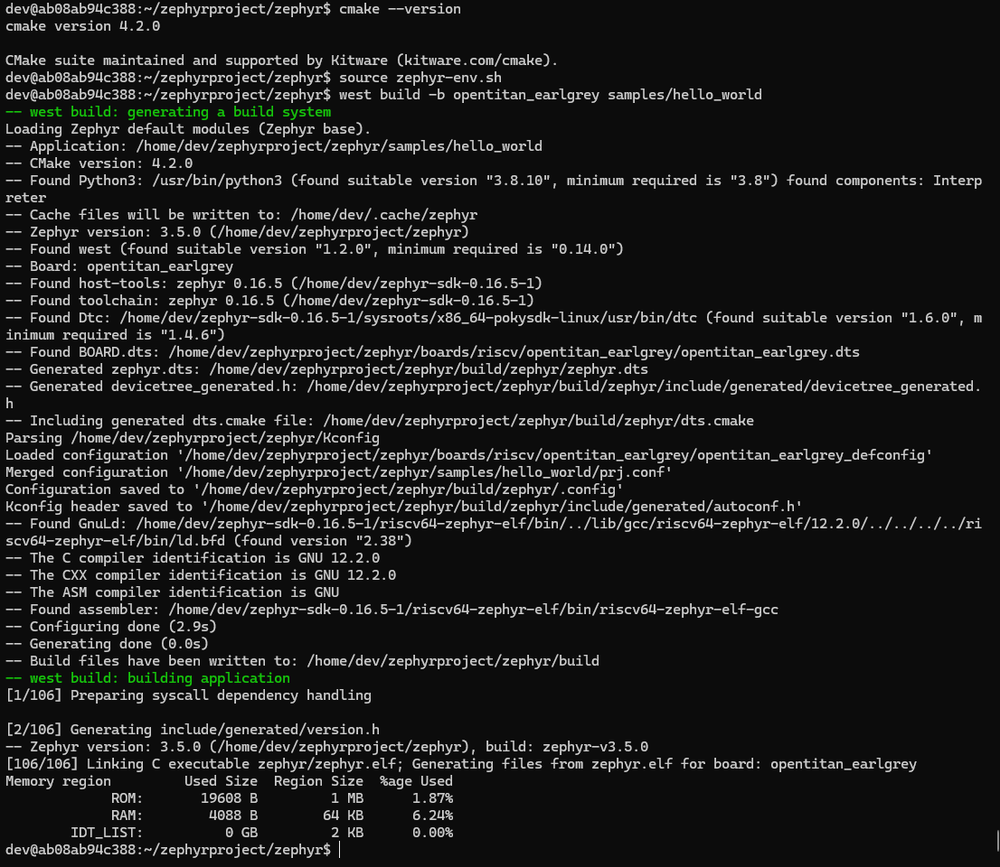

# Попытка запуска Zephyr на контейнере

### 1. Клонирование репозитория OpenTitan

Клонирование репозитория и checkout нужного commit осуществляется при помощи следующих команд:

```bash
cd $HOME
git clone https://github.com/lowRISC/opentitan.git
cd opentitan
git checkout 6a3c2e988e
git branch earlgrey_silver_release_v5 6a3c2e988e
git switch earlgrey_silver_release_v5
```

### 2. Сборка Docker-контейнера OpenTitan

Сборка контейнера осуществляется при помощи команды:

```bash
cd $HOME/opentitan
sudo docker build -t opentitan -f util/container/Dockerfile .
```

### 3. Запуск контейнера

Для работы в контейнере мы смонтируем каталоги `opentitan/` (содержит исходники OpenTitan) и `zephyrproject/` (монорепозиторий Zephyr):

```bash
sudo docker run -it --name opentitan-dev -v "$HOME/opentitan:/home/dev/opentitan" -v "$HOME/zephyrproject:/home/dev/zephyrproject" --env DEV_UID=$(id -u) --env DEV_GID=$(id -g) opentitan:latest bash
```

### 4. Установка и настройка Zephyr внутри контейнера

Контейнер уже содержит Python3, но `west` нужно добавить:

```bash
pip3 install --user west
```

Инициализация `zephyrproject` версии `v3.5.0`:

```bash
mkdir -p /home/dev/zephyrproject
cd /home/dev/zephyrproject
west init -m https://github.com/zephyrproject-rtos/zephyr --mr v3.5.0 .
west update
```

Установка Zephyr SDK `v0.16.5-1`:

```bash
cd /home/dev
wget https://github.com/zephyrproject-rtos/sdk-ng/releases/download/v0.16.5-1/zephyr-sdk-0.16.5-1_linux-x86_64.tar.xz

tar xvf zephyr-sdk-0.16.5-1_linux-x86_64.tar.xz
cd zephyr-sdk-0.16.5-1
./setup.sh
```

### 5. Сборка Zephyr `hello_world` под `opentitan_earlgrey`

Внутри контейнера запускаем следующие команды:

```bash
source zephyr-env.sh
west build -b opentitan_earlgrey samples/hello_world
```



Исполняемый файл `zephyr.elf` собрался.

### 6. Собираем ROM + OTP

Собираем тестовый ROM и OTP-образ:

```bash
./bazelisk.sh build \
//sw/device/lib/testing/test_rom:test_rom_sim_verilator \   //hw/ip/otp_ctrl/data:img_rma
```

### 7. Запуск Zephyr на OpenTitan

Запускаем Zephyr при помощи команды:

```bash
bazel-bin/hw/build.verilator_real/sim-verilator/Vchip_sim_tb --verbose-mem-load \
  -r "$ROM_VMEM" \
  --meminit=otp,"$OTP_VMEM" \
  --meminit=flash,"$ZEPHYR_ELF"
```

При запуске команды возникает следующая ошибка:

```bash
...
File "/home/dev/.cache/bazel/_bazel_dev/3be28635fd3b6ca3d988266241e7c46b/external/rules_python/python/pip_install/extract_wheels/lib/wheel.py", line 57, in entry_points name = "{}-{}".format(metadata.name.replace("-", "_"), metadata.version) AttributeError: 'NoneType' object has no attribute 'replace' ) ERROR: Analysis of target '//hw/ip/otp_ctrl/data:img_rma' failed; build aborted: Analysis failed INFO: Elapsed time: 46.558s INFO: 0 processes. FAILED: Build did NOT complete successfully (120 packages loaded, 2436 targets configured) currently loading: util/design ... (4 packages)
```

Это обычный баг связки старого `rules_python` и новых `PyPI` - формат представления Python-пакетов ушел далеко вперёд относительно того коммита OpenTitan.

На текущем этапе достигнут устойчивый прогресс: часть Zephyr полностью воспроизведена и собрана корректно под `opentitan_earlgrey`, однако выявлена ключевая блокировка, которая не дает нам продолжить работу - несовместимость исторического `rules_python` с современными python wheels.


