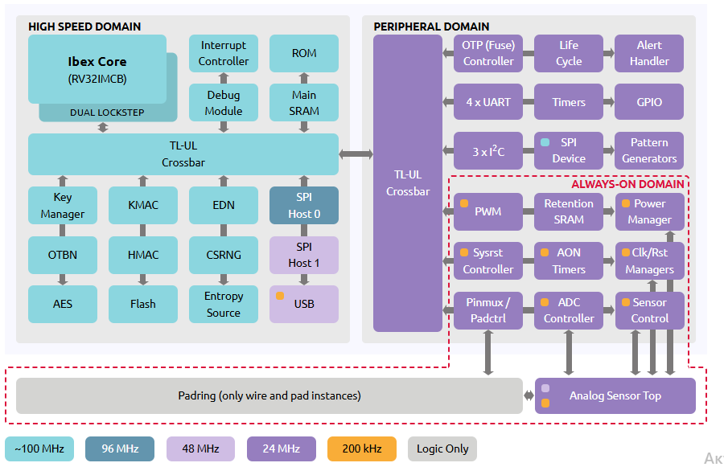

# Общие положения
В документе приведено описание проекта OpenTitan, версия для FPGA (commit 0f6fcf0c81bd86bfb7b7de258a031248a1a6da94, от 6 октября 2025 года). Эта версия называется Earlgrey. На рисунке показана блок-схема проекта:

Моделирование проекта проводилось с помощью QuestaSim-64 2024.1

Следует заметить, что на рисунке (с официального сайта проекта) показаны связи вычислительных блоков, таких как AES, HMAC, KMAC и т.д. только с шиной TL-UL, то есть с процессором RISC-V. Однако, в проекте также есть прямые связи между некоторыми блоками. Например, у контроллера OTP есть прямые связи (точка-точка, не через шину TL-UL), с такими блоками, как EDN, Key Manager, OTBN и т.д. У модуля Key Manager есть прямые связи с AES, KMAC, OTBN, b и т.д. Это очень важно, так как такие связи обеспечивают обмен секретной информацией ТОЛЬКО между модулями, в обход процессора. Например, контроллер OTP считывает ключи из памяти OTP и передает их напрямую модулю Key Manager. Затем модуль Key Manager вырабатывает набор производных ключей, и раздает их вычислительным модулям - AES, KMAC, и т.д. Процессор RISC-V может пользоваться сервисами вычислительных модулей, но не имеет доступа к секретной информации, такой как ключи. И поэтому даже если пользовательская программа захватит управление процессором, она не сможет получить доступ к секретам, так как у процессора в принципе нет такого доступа.
Более подробно прямые связи будут рассмотрены ниже.

