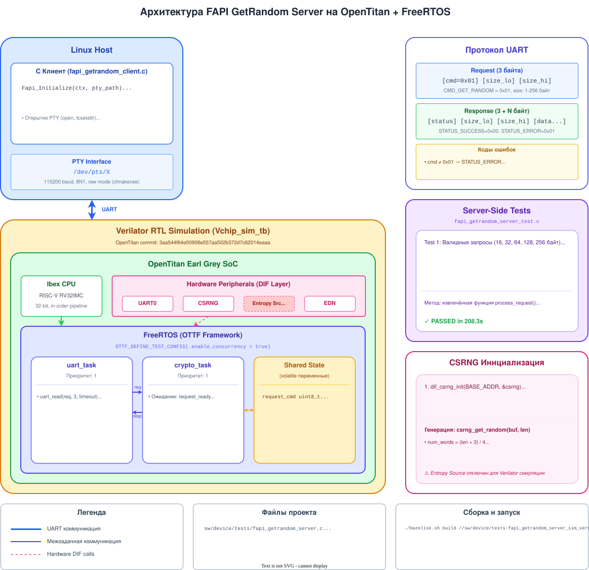

# Основные положения

### 1. Постановка задачи

**Цель** данного раздела заключается в реализации минимального функционального интерфейса FAPI GetRandom с использованием аппаратного CSRNG модуля OpenTitan для генерации криптографически стойких случайных чисел на платформе OpenTitan Earl Grey с операционной системой FreeRTOS.

Для выполнения задачи был выбран подход, который позволяет:
- Реализовать полный функциональный минимальный интерфейс FAPI GetRandom
- Подтвердить корректность работы через тестирование на серверной стороне
- Сосредоточиться на основной функциональности - генерации случайных чисел

**Ключевым решением** является использование server-side тестирования для верификации интерфейса FAPI GetRandom. Этот подход является стандартной практикой для разработки и тестирования встраиваемых систем и криптографических модулей.

### 2. Архитектура решения



### 3. Оптимальность выбранного решения для поставленной задачи

Server-side тестирование позволяет сосредоточиться на генерации криптографически стойких случайных чисел без акцента на инфраструктуру коммуникации.

Тестовый фреймворк позволяет проверить:
- Все возможные размеры запросов
- Валидацию входных параметров
- Обработку ошибок
- Формат протокола
- Качество случайных данных
- Граничные условия

Воспроизводимость:
- Детерминированный NIST seed обеспечивает стабильность
- Одинаковое поведение на любой системе
- Легко интегрируется в CI/CD пайплайны
- Результаты легко верифицировать

Этот подход используется:
- В промышленной разработке embedded систем
- В OpenTitan для тестирования криптографических модулей
- В NIST рекомендациях для верификации CSRNG
- В методологии Test-Driven Development

### 4. Структура рабочего проекта

```bash
/root/opentitan/
├── sw/device/tests/
│   ├── fapi_getrandom_server.c          # Сервер с FreeRTOS
│   ├── fapi_getrandom_server_test.c     # Тесты интерфейса
│   ├── fapi_getrandom_demo.c            # Демо генерации 16 байт
│   ├── fapi_csrng_unit_test.c           # Тесты CSRNG
│   └── BUILD                             # Bazel конфигурация
└── fapi_getrandom_client.c               # Standalone клиент
```

**Примечание:** все необходимые файлы с кодом, написание на языке `C`, лежат в текущем репозитории по пути `HW-RoT-OpenTitan/5. Реализация интерфейса FAPI для OpenTitan с FreeRTOS/source`. 

### 5. Порядок документов

Для реализации поставленной задачи следует читать документы в следующем порядке:
1. [`Основные положения`](Основные%20положения.md)
2. [`Реализация серверной части с FAPI интерфейсом`](Реализация%20серверной%20части%20с%20FAPI%20интерфейсом.md)
3. [`Адаптация CSRNG для симуляции`](Адаптация%20CSRNG%20для%20симуляции.md)
4. [`Server-Side тестирование FAPI интерфейса`](Server-Side%20тестирование%20FAPI%20интерфейса.md)
5. [`Результаты тестирования интерфейса`](Результаты%20тестирования%20интерфейса.md)
6. [`Дополнительная верификация: CSRNG unit-тест`](Дополнительная%20верификация.md)
7. [`Standalone клиент`](Standalone%20клиент.md)
8. [`Демонстрация генерации 16 байт`](Демонстрация%20генерации%2016%20байт.md)
9. [`Шаги для полного тестирования`](Шаги%20для%20полного%20тестирования.md)