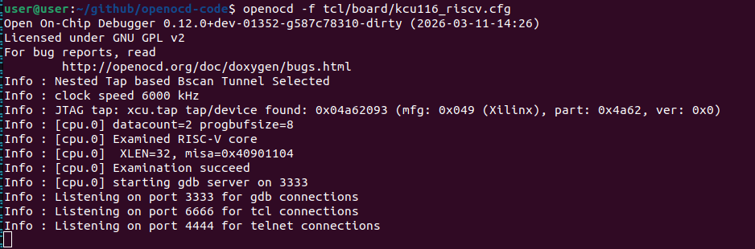

### 1.Введение
В разделе описано подключение OpenOCD к ядру RISC-V, выполненному на ПЛИС xcku5p-ffvb676-2-e (семейство Xilinx Kintex US+)на базе отладочной платы KCU116.
Обычно для отладки RISC-V выделяется отдельный JTAG, который используется только для RISC-V. Для связи с JTAG ПЛИС используется другой канал.
Но на отладочной плате KCU116 для организации канала связи JTAG используется модуль digilent_jtag_smt2_nc У этого модуля всего один канал JTAG, который нужно использовать и для связи с ПЛИС (например для загрузки прошивки), и для связи с ядром RISC-V (например для подключения GDB или обновления софта процессора).
В документе описан способ совместного использования JTAG для ПЛИС и RISC-V.

Предполагается, что OpenOCD уже установлен и настроены доступы USB-устройств.

### 2. Примитив BSCANE2
Во многих ПЛИС Xilinx предусмотрена возможность использования JTAG для внутренних модулей ПЛИС (каким например является ядро RISC-V). Для этого необходимо использовать примитив BSCANE2. Этот примитив на языке Verilog выглядит следующим образом:
```
BSCANE2 #(
  .JTAG_CHAIN(4)
  )
  BSCANE2_inst (
    .CAPTURE(),
    .DRCK(),
    .RESET(),
    .RUNTEST(),
    .SEL(),
    .SHIFT(),
    .TCK(),
    .TDI(),
    .TMS(),
    .UPDATE(),
    .UPDATE(),
    .TDO()
  );
```
В рассатриваемой ПЛИС есть четыре таких примитива, и в принципе можно использовать любой. Однако OpenOCD по умолчанию подключается к примитиву с номером 4. Поэтому в примере показан именно этот  вариант (JTAG_CHAIN(4)). К BSCANE2 необходимо подключить адаптер (в данном примере модуль называется bscan2jtag_conv), который преобразует данные от BSCANE2 в формат сигналов JTAG (то есть tdi,tdo,tms,tck,trstn). И эти сигналы существуют уже внутри ПЛИС и могут быть подключены к внутреннему потребителю.

### 3. Организация туннеля JTAG

Суть такого подключения (туннеля JTAG) заключается в том, что команда ir передается USER4, то есть адресована этому примитиву BSCANE2, а затем ir и dr для внутреннего потребителя передается через инструкции dr. Стандарта для такой передачи не существует, поэтому адаптер bscan2jtag_conv должен быть реализован в соответствии с конкретной программной моделью передачи данных.
Для OpenOCD - это функция dtmcs_scan_via_bscan в файле riscv.c. В этой функции описан порядок отправки данных. Также следует заметить, что нужно использовать вариант BSCAN_TUNNEL_NESTED_TAP.
Исходный код конвертера на языке Verilog находится в папке src. Этот модуль подключается к BSCANE2 и как правило определяется в топовом модуле проекта.

### 4. Конфигурация и запуск OpenOCD
Все конфигурационные файлы расположены в папке openocd_config.
Пример прошивки для отладочной платы KCU116 c ядром RISC-V находится в папке bin.
Сначала нужно загрузить прошивку средствами OpenOCD. Для этого используется команда:
```
openocd -f tcl/board/kcu116.cfg -c "init" -c "pld load 0 bit_file.bit"
```

Скорость загрузки прошивки зависит от скорости JTAG. С конфигурационным файлом из этого примера загрузка занимает примерно 20 секунд. После загрузки прошивки запускаем конфиг для подключения к OpenOCD:
```
openocd -f tcl/board/kcu116_riscv.cfg
```
После исполнения этого конфигурационного файла должна определиться и ПЛИС, и RISC-V, как это показано на картинке:


