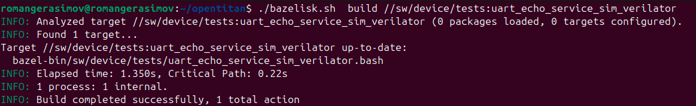
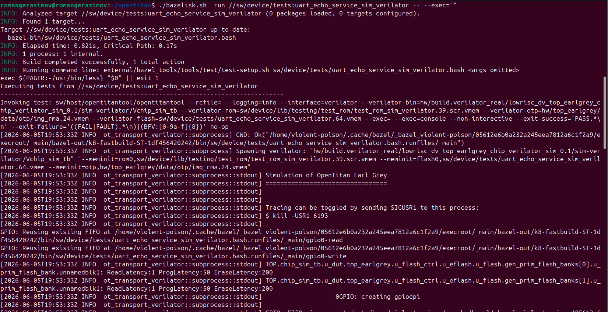
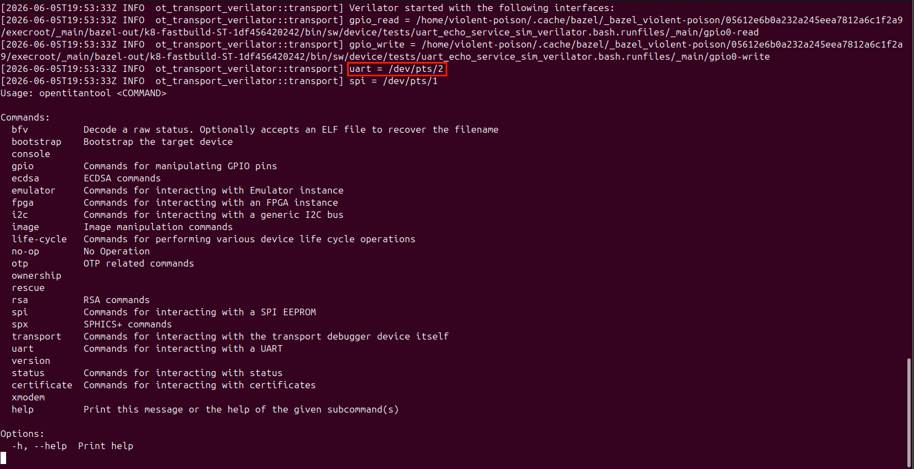
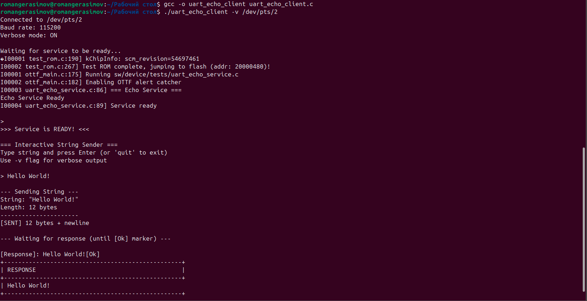

# Практическая работа №1. Разработка UART-сервиса эхо-повтора на платформе OpenTitan + FreeRTOS

## 1. Результат работы

- **Встраиваемый эхо-сервис** под FreeRTOS на платформе OpenTitan (симуляция Verilator): принимает строки по UART и возвращает их обратно с маркерами `[Response]:` и `[Ok]`.
- **Хост-клиент** на C: подключается к симулированному UART (PTY), отправляет строки, парсит ответ по маркерам, извлекает эхо-строку и выводит результат.
- **Сборка**: сервис собирается через Bazel в дереве OpenTitan, клиент компилируется отдельно штатным GCC.

---

## 2. Полная инструкция по реализации

### 2.1. Разработка FreeRTOS-сервиса

**Постановка задачи:** FreeRTOS-задача, которая инициализирует UART через DIF (Device Interface Functions), в бесконечном цикле читает строки и отправляет их обратно с маркерами для автоматического парсинга клиентом.

**Используемые зависимости:**

| Зависимость | Назначение |
|-------------|------------|
| `dif_uart.h` | Device Interface Functions для UART — низкоуровневый драйвер |
| `mmio.h` | Memory-mapped I/O — доступ к регистрам периферии |
| `top_earlgrey.h` | Адреса периферии (конкретно `TOP_EARLGREY_UART0_BASE_ADDR`) |
| `ottf_main.h` | Фреймворк тестирования, запускающий FreeRTOS |
| `log.h` | Отладочный вывод в UART (`LOG_INFO`) |

**Инициализация UART:**

```c
mmio_region_t uart_base = mmio_region_from_addr(TOP_EARLGREY_UART0_BASE_ADDR);
    CHECK_DIF_OK(dif_uart_init(uart_base, &uart));
```

- `mmio_region_from_addr()` — оборачивает физический адрес UART0 в структуру `mmio_region_t`
- `dif_uart_init()` — инициализирует драйвер: сохраняет базовый адрес, настраивает регистры

**Отправка данных:**

```c
dif_uart_bytes_send(&uart, (uint8_t *)str, len, &sent);
```

- Принимает указатель на структуру `dif_uart_t`, буфер данных, длину
- Возвращает реально отправленное количество байт через `sent`
- Работает через запись в регистр `UART_WDATA` и ожидание флага `UART_TXFULL`

**Приём данных:**

```c
dif_uart_bytes_receive(&uart, 1, &ch, &recv);
```

- Запрашивает 1 байт из аппаратного FIFO
- Читает регистр `UART_RDATA`
- Возвращает `kDifOk` и количество принятых байт

**Основной цикл обработки:**

```c
while (true) {
    uart_send_string("\n> ");
    size_t len = uart_receive_string(buffer, MAX_BUFFER_SIZE);
    if (len > 0) {
        uart_send_string("\n[Response]: ");
        uart_send_string(buffer);
        uart_send_string("[Ok]\n");
        LOG_INFO("Received: \"%s\" (%zu chars)", buffer, len);
    }
}
```

1. Вывод приглашения `> `
2. Блокирующее ожидание строки (читает символы до `\n`)
3. Эхо-ответ с маркерами `[Response]:` и `[Ok]`
4. Логирование через `LOG_INFO` (уходит в тот же UART)

#### 2.1.1. Код сервиса

**Файл:** `~/opentitan/sw/device/tests/uart_echo_service.c`

```c
#include "sw/device/lib/runtime/log.h"
#include "sw/device/lib/testing/test_framework/ottf_main.h"
#include "sw/device/lib/dif/dif_uart.h"
#include "sw/device/lib/base/mmio.h"
#include "hw/top_earlgrey/sw/autogen/top_earlgrey.h"

OTTF_DEFINE_TEST_CONFIG();

static dif_uart_t uart;

#define MAX_BUFFER_SIZE 256

static size_t my_strlen(const char *str) {
    size_t len = 0;
    while (str[len]) len++;
    return len;
}

// Отправка строки с гарантией отправки всех байтов
void uart_send_string(const char *str) {
    size_t sent;
    size_t len = my_strlen(str);
    size_t total_sent = 0;
    
    while (total_sent < len) {
        CHECK_DIF_OK(dif_uart_bytes_send(&uart, (uint8_t *)(str + total_sent), 
                                         len - total_sent, &sent));
        total_sent += sent;
        
        // Микрозадержка, чтобы дать UART время на отправку
        if (sent < (len - total_sent)) {
            for (volatile int d = 0; d < 100; d++);
        }
    }
}

// Отправка одного символа
void uart_send_char(char ch) {
    size_t sent;
    size_t total_sent = 0;
    
    while (total_sent < 1) {
        CHECK_DIF_OK(dif_uart_bytes_send(&uart, (uint8_t *)&ch, 1, &sent));
        total_sent += sent;
        if (sent < 1) {
            for (volatile int d = 0; d < 50; d++);
        }
    }
}

// Функция для чтения строки из UART
size_t uart_receive_string(char *buffer, size_t max_len) {
    size_t index = 0;
    uint8_t ch;
    size_t recv;
    
    while (index < max_len - 1) {
        if (dif_uart_bytes_receive(&uart, 1, &ch, &recv) == kDifOk && recv) {
            // Проверяем символы конца строки
            if (ch == '\n' || ch == '\r') {
                if (index > 0) {
                    break;
                }
            } else if (ch == '\b' || ch == 0x7f) { // Backspace/Delete
                if (index > 0) {
                    index--;
                    uart_send_char('\b');
                    uart_send_char(' ');
                    uart_send_char('\b');
                }
            } else if (ch >= 32 && ch <= 126) { // Только печатные символы
                buffer[index++] = (char)ch;
            }
        }
    }
    
    buffer[index] = '\0';
    return index;
}

bool test_main(void) {
    mmio_region_t uart_base = mmio_region_from_addr(TOP_EARLGREY_UART0_BASE_ADDR);
    CHECK_DIF_OK(dif_uart_init(uart_base, &uart));
    
    LOG_INFO("=== Echo Service ===");
    
    uart_send_string("Echo Service Ready\n");
    LOG_INFO("Service ready");

    while (true) {
        char buffer[MAX_BUFFER_SIZE];
        
        uart_send_string("\n> ");
        
        size_t len = uart_receive_string(buffer, MAX_BUFFER_SIZE);
        
        if (len > 0) {
            uart_send_string("\n[Response]: ");
            uart_send_string(buffer);
            uart_send_string("[Ok]\n");
            
            LOG_INFO("Received: \"%s\" (%zu chars)", buffer, len);
        }
    }
    return true;
}
```
#### 2.1.2. Конфигурация сборки Bazel

**Файл:** `~/opentitan/sw/device/tests/BUILD`

```python
opentitan_test(
    name = "uart_echo_service",
    srcs = [
        "uart_echo_service.c",
        "@freertos//:tasks.c",
        "@freertos//:list.c",
        "@freertos//:queue.c",
        "@freertos//:portable/MemMang/heap_1.c",
    ],
    copts = [
        "-fno-lto",
        "-DINCLUDE_vTaskDelay=1",
    ],
    linkopts = [
        "-fno-lto",
    ],
    exec_env = {
        "//hw/top_earlgrey:sim_verilator": None,
    },
    deps = [
        "//hw/top/dt",
        "//sw/device/lib/arch:device",
        "//sw/device/lib/base:mmio",
        "//sw/device/lib/dif:uart",
        "//sw/device/lib/dif:csrng",
        "//sw/device/lib/runtime:log",
        "//sw/device/lib/runtime:hart",
        "//sw/device/lib/testing/test_framework:ottf_main",
        "//sw/device/lib/testing/test_framework:freertos_port",
        "//third_party/freertos:freertos",
    ],
)
```

**Описание параметров сборки:**

| Параметр | Значение | Назначение |
|----------|----------|------------|
| `name` | `"uart_echo_service"` | Имя цели сборки |
| `srcs` | `uart_echo_service.c` + исходники FreeRTOS | Исходные файлы сервиса и ядра FreeRTOS (`tasks.c`, `list.c`, `queue.c`) |
| `srcs` | `heap_1.c` | Простейший менеджер памяти для FreeRTOS (выделяет память статически, без освобождения) |
| `copts` | `-fno-lto` | Отключает межпроцедурную оптимизацию (Link Time Optimization), которая может нарушать работу с периферией |
| `copts` | `-DINCLUDE_vTaskDelay=1` | Включает в сборку функцию `vTaskDelay()` для возможности задержек в задаче |
| `exec_env` | `sim_verilator` | Указывает, что тест выполняется в симуляторе Verilator |
| `deps` | `//sw/device/dif:uart` | DIF-драйвер UART для работы с последовательным портом |
| `deps` | `//third_party/freertos:freertos` | Зависимость от FreeRTOS |
| `deps` | `//sw/device/lib/testing/test_framework:ottf_main` | Фреймворк OTTF, запускающий `test_main()` в контексте FreeRTOS |

**Особенности сборки для Verilator:**

- Используется `heap_1.c` — простейший аллокатор FreeRTOS, подходящий для симуляции (не требует сложного управления памятью)
- `-fno-lto` обязателен для корректной работы DIF-функций, иначе может происходить неверная оптимизация обращений к регистрам
- Зависимость `csrng` добавлена для совместимости, хотя в эхо-сервисе не используется (требуется некоторыми тестовыми фреймворками)

### 2.2. Сборка и запуск симуляции

```bash
cd ~/opentitan
./bazelisk.sh build //sw/device/tests:uart_echo_service_sim_verilator
./bazelisk.sh run //sw/device/tests:uart_echo_service_sim_verilator -- --exec=""
```




В логах симуляции появится строка:
```
UART: Created /dev/pts/X for uart0
```
Номер `X` — виртуальный последовательный порт для хост-клиента.

---

### 2.3. Хост-клиент

**Постановка задачи:** Программа, которая подключается к PTY, дожидается готовности сервиса, отправляет строки, принимает ответ, извлекает из него эхо-строку по маркерам и выводит результат.

**Используемые зависимости:**

| Зависимость | Назначение |
|-------------|------------|
| `stdio.h` | Стандартный ввод/вывод (printf, perror) |
| `stdlib.h` | Стандартные утилиты (atoi, exit) |
| `string.h` | Работа со строками (strlen, strstr, strcmp) |
| `unistd.h` | POSIX API (read, write, usleep, tcdrain) |
| `fcntl.h` | Флаги открытия файлов (O_RDWR, O_NOCTTY, O_SYNC) |
| `termios.h` | Управление последовательным портом (struct termios) |
| `errno.h` | Коды ошибок |
| `time.h` | Работа со временем (time_t, time) |

**Настройка последовательного порта:**

```c
int open_serial(const char *device) {
    int fd = open(device, O_RDWR | O_NOCTTY | O_SYNC);
    
    struct termios tty;
    tcgetattr(fd, &tty);
    
    cfsetospeed(&tty, B115200);
    cfsetispeed(&tty, B115200);
    
    tty.c_cflag |= (CLOCAL | CREAD);
    tty.c_cflag &= ~CSIZE; tty.c_cflag |= CS8;
    tty.c_cflag &= ~PARENB;
    tty.c_cflag &= ~CSTOPB;
    tty.c_cflag &= ~CRTSCTS;
    
    tty.c_lflag &= ~(ICANON | ECHO | ECHOE | ISIG);
    tty.c_iflag &= ~(IXON | IXOFF | IXANY);
    tty.c_oflag &= ~OPOST;
    
    tty.c_cc[VMIN] = 0;
    tty.c_cc[VTIME] = 1;
    
    tcsetattr(fd, TCSANOW, &tty);
    return fd;
}
```

**Параметры настройки:**

| Параметр | Значение | Назначение |
|----------|----------|------------|
| `B115200` | 115200 бод | Скорость передачи, соответствует настройкам сервиса |
| `CS8` | 8 бит данных | Стандартный размер символа |
| `PARENB` | отключён | Без бита чётности |
| `CSTOPB` | отключён | 1 стоп-бит |
| `CRTSCTS` | отключён | Без аппаратного управления потоком |
| `ICANON` | отключён | Канонический режим выключен (чтение посимвольное) |
| `ECHO` | отключён | Без локального эха |
| `VMIN` | 0 | Минимальное количество символов для чтения |
| `VTIME` | 1 | Таймаут 0.1 секунды |

**Ожидание готовности сервиса:**

```c
int wait_for_service(int fd, options_t opts) {
    while (1) {
        int n = read(fd, buf + total, BUFFER_SIZE - total - 1);
        if (n > 0) {
            if (strstr(buf, "Service ready") || 
                strstr(buf, "Echo Service Ready")) {
                return 1;
            }
        }
        usleep(100000);
    }
}
```

- Читает данные из UART до появления маркера `"Service ready"` или `"Echo Service Ready"`
- Поддерживает таймаут через `opts.timeout_sec`
- В verbose-режиме выводит все принятые данные в реальном времени

**Чтение ответа до маркера [Ok]:**

```c
void read_until_ok(int fd, char *response, int response_size, options_t opts) {
    while (total < response_size - 1) {
        int n = read(fd, response + total, response_size - total - 1);
        if (n > 0) {
            total += n;
            response[total] = '\0';
            if (strstr(response, "[Ok]")) {
                break;
            }
        }
        usleep(10000);
    }
}
```

- Читает данные, пока не встретит маркер `[Ok]`
- Позволяет собирать полный ответ, даже если он приходит частями
- Задержка 10ms между проверками снижает нагрузку на процессор

**Отправка строки и парсинг ответа:**

```c
void send_string_to_uart(int fd, const char *str, options_t opts) {
    clear_input_buffer(fd);
    write(fd, str, len);
    write(fd, "\n", 1);
    tcdrain(fd);
    
    read_until_ok(fd, response, BUFFER_SIZE, opts);
    
    char *response_start = strstr(response, "[Response]:");
    char *ok_marker = strstr(response, "[Ok]");
    
    if (response_start && ok_marker) {
        response_start += 11;
        // Копируем текст между маркерами
        while (response_start + i < ok_marker) {
            clean_response[i++] = response_start[i];
        }
        printf("| %s\n", clean_response);
    }
}
```

1. Очищает входной буфер перед отправкой
2. Отправляет строку + символ новой строки
3. `tcdrain()` ждёт завершения отправки всех данных
4. Читает ответ до маркера `[Ok]`
5. Извлекает текст между `[Response]:` и `[Ok]`
6. Выводит очищенный ответ в форматированной рамке

**Интерактивный режим:**

```c
while (1) {
    printf("> ");
    fflush(stdout);
    
    fgets(input, sizeof(input), stdin);
    input[strcspn(input, "\n")] = '\0'];
    
    if (strcmp(input, "quit") == 0) break;
    
    send_string_to_uart(fd, input, opts);
}
```

- Бесконечный цикл ввода строк
- Команда `quit` завершает программу
- Каждая введённая строка отправляется сервису

#### 2.3.1. Код клиента

**Файл:** `~/uart_echo_client.c`

```c
#include <stdio.h>
#include <stdlib.h>
#include <string.h>
#include <unistd.h>
#include <fcntl.h>
#include <termios.h>
#include <errno.h>
#include <time.h>

#define BUFFER_SIZE 8192
#define MAX_STRING_LEN 1024

typedef struct {
    int wait_for_ready;
    int verbose;
    int timeout_sec;
} options_t;

int open_serial(const char *device) {
    int fd = open(device, O_RDWR | O_NOCTTY | O_SYNC);
    if (fd < 0) {
        perror("open");
        return -1;
    }
    
    struct termios tty;
    memset(&tty, 0, sizeof(tty));
    tcgetattr(fd, &tty);
    
    cfsetospeed(&tty, B115200);
    cfsetispeed(&tty, B115200);
    
    tty.c_cflag |= (CLOCAL | CREAD);
    tty.c_cflag &= ~CSIZE;
    tty.c_cflag |= CS8;
    tty.c_cflag &= ~PARENB;
    tty.c_cflag &= ~CSTOPB;
    tty.c_cflag &= ~CRTSCTS;
    
    tty.c_lflag &= ~(ICANON | ECHO | ECHOE | ISIG);
    tty.c_iflag &= ~(IXON | IXOFF | IXANY);
    tty.c_oflag &= ~OPOST;
    
    tty.c_cc[VMIN] = 0;
    tty.c_cc[VTIME] = 1;
    
    tcsetattr(fd, TCSANOW, &tty);
    return fd;
}

int wait_for_service(int fd, options_t opts) {
    if (!opts.wait_for_ready) {
        printf("Skipping service ready check (--no-wait)\n");
        return 1;
    }
    
    printf("Waiting for service to be ready");
    if (opts.timeout_sec > 0) {
        printf(" (timeout: %ds)", opts.timeout_sec);
    }
    printf("...\n");
    
    char buf[BUFFER_SIZE] = {0};
    int total = 0;
    time_t start = time(NULL);
    
    while (1) {
        int n = read(fd, buf + total, BUFFER_SIZE - total - 1);
        if (n > 0) {
            total += n;
            buf[total] = '\0';
            
            if (opts.verbose) {
                printf("%s", buf + total - n);
                fflush(stdout);
            }
            
            if (strstr(buf, "Service ready") || 
                strstr(buf, "Echo Service Ready")) {
                printf("\n>>> Service is READY! <<<\n\n");
                return 1;
            }
        }
        
        if (opts.timeout_sec > 0 && time(NULL) - start >= opts.timeout_sec) {
            printf("\n!!! Timeout waiting for service !!!\n");
            return 0;
        }
        
        usleep(100000);
    }
}

void clear_input_buffer(int fd) {
    char dummy[256];
    while (read(fd, dummy, sizeof(dummy)) > 0) {
        usleep(10000);
    }
}

void read_until_ok(int fd, char *response, int response_size, options_t opts) {
    int total = 0;
    response[0] = '\0';
    
    while (total < response_size - 1) {
        int n = read(fd, response + total, response_size - total - 1);
        if (n > 0) {
            total += n;
            response[total] = '\0';
            
            if (opts.verbose) {
                printf("%.*s", n, response + total - n);
                fflush(stdout);
            }
            
            if (strstr(response, "[Ok]")) {
                break;
            }
        }
        usleep(10000);
    }
}

void send_string_to_uart(int fd, const char *str, options_t opts) {
    size_t len = strlen(str);
    
    printf("\n--- Sending String ---\n");
    printf("String: \"%s\"\n", str);
    printf("Length: %zu bytes\n", len);
    printf("----------------------\n");
    
    clear_input_buffer(fd);
    
    write(fd, str, len);
    write(fd, "\n", 1);
    tcdrain(fd);
    
    printf("[SENT] %zu bytes + newline\n", len);
    printf("\n--- Waiting for response (until [Ok] marker) ---\n");
    
    char response[BUFFER_SIZE] = {0};
    read_until_ok(fd, response, BUFFER_SIZE, opts);
    
    printf("\n");
    printf("+--------------------------------------------------+\n");
    printf("| RESPONSE                                         |\n");
    printf("+--------------------------------------------------+\n");
    
    if (strlen(response) > 0) {
        char *response_start = strstr(response, "[Response]:");
        char *ok_marker = strstr(response, "[Ok]");
        
        if (response_start && ok_marker) {
            response_start += 11;
            while (*response_start == ' ') response_start++;
            
            char clean_response[MAX_STRING_LEN];
            int i = 0;
            while (response_start + i < ok_marker && i < MAX_STRING_LEN - 1) {
                clean_response[i] = response_start[i];
                i++;
            }
            clean_response[i] = '\0';
            
            int rlen = strlen(clean_response);
            while (rlen > 0 && (clean_response[rlen-1] == '\n' || clean_response[rlen-1] == '\r')) {
                clean_response[--rlen] = '\0';
            }
            
            printf("| %s\n", clean_response);
        } else {
            printf("| (malformed response)\n");
            if (opts.verbose) {
                printf("| Raw: %s\n", response);
            }
        }
    } else {
        printf("| (NO RESPONSE RECEIVED)                        |\n");
    }
    
    printf("+--------------------------------------------------+\n\n");
}

void print_usage(const char *prog) {
    printf("Usage: %s [OPTIONS] /dev/pts/N [string]\n", prog);
    printf("\nOPTIONS:\n");
    printf("  --no-wait       Don't wait for service ready message\n");
    printf("  --wait          Wait for service ready (default)\n");
    printf("  --timeout N     Wait timeout in seconds (0=infinite)\n");
    printf("  -v, --verbose   Show all UART output\n");
    printf("  -h, --help      This help\n");
    printf("\nEXAMPLES:\n");
    printf("  %s /dev/pts/2                      # Interactive mode\n", prog);
    printf("  %s -v /dev/pts/2 \"Hello World\"    # Verbose mode\n", prog);
}

int main(int argc, char *argv[]) {
    options_t opts = {
        .wait_for_ready = 1,
        .verbose = 0,
        .timeout_sec = 0
    };
    
    char *device = NULL;
    char *string_to_send = NULL;
    
    for (int i = 1; i < argc; i++) {
        if (strcmp(argv[i], "--no-wait") == 0) {
            opts.wait_for_ready = 0;
        } else if (strcmp(argv[i], "--wait") == 0) {
            opts.wait_for_ready = 1;
        } else if (strcmp(argv[i], "--timeout") == 0 && i + 1 < argc) {
            opts.timeout_sec = atoi(argv[++i]);
        } else if (strcmp(argv[i], "-v") == 0 || strcmp(argv[i], "--verbose") == 0) {
            opts.verbose = 1;
        } else if (strcmp(argv[i], "-h") == 0 || strcmp(argv[i], "--help") == 0) {
            print_usage(argv[0]);
            return 0;
        } else if (argv[i][0] == '/') {
            device = argv[i];
        } else {
            string_to_send = argv[i];
        }
    }
    
    if (!device) {
        printf("ERROR: No device specified\n\n");
        print_usage(argv[0]);
        return 1;
    }
    
    int fd = open_serial(device);
    if (fd < 0) return 1;
    
    printf("Connected to %s\n", device);
    printf("Baud rate: 115200\n");
    if (opts.verbose) printf("Verbose mode: ON\n");
    printf("\n");
    
    if (!wait_for_service(fd, opts)) {
        close(fd);
        return 1;
    }
    
    if (string_to_send) {
        send_string_to_uart(fd, string_to_send, opts);
    } else {
        printf("=== Interactive String Sender ===\n");
        printf("Type string and press Enter (or 'quit' to exit)\n");
        printf("Use -v flag for verbose output\n\n");
        
        char input[MAX_STRING_LEN];
        while (1) {
            printf("> ");
            fflush(stdout);
            
            if (!fgets(input, sizeof(input), stdin)) {
                break;
            }
            
            input[strcspn(input, "\n")] = '\0';
            
            if (strcmp(input, "quit") == 0) {
                printf("Exiting...\n");
                break;
            } else if (strlen(input) > 0) {
                send_string_to_uart(fd, input, opts);
            }
        }
    }
    
    close(fd);
    return 0;
}
```

#### 2.3.2. Компиляция и использование

```bash
gcc -o uart_echo_client uart_echo_client.c

# Примеры запуска:
./uart_echo_client /dev/pts/X                 # Интерактивный режим
./uart_echo_client --no-wait /dev/pts/X "Hello"  # Однострочный режим
./uart_echo_client -v /dev/pts/X              # Подробный вывод
```

---

_Для запуска использовался флаг "-v" (подробный вывод), подключение по выданному при запуске сервиса виртуальному интерфейсу "/dev/pts/2"_

## 4. Структура файлов

```
opentitan/
├── sw/device/tests/
│   ├── uart_echo_service.c
│   └── BUILD
uart_echo_client.c
```

---

## 5. Проверка корректности работы

### 5.1. Успешный сценарий

```
> hello world

--- Sending String ---
String: "hello world"
Length: 11 bytes
----------------------

--- Waiting for response (until [Ok] marker) ---

+--------------------------------------------------+
| RESPONSE                                         |
+--------------------------------------------------+
| hello world
+--------------------------------------------------+
```

### 5.2. Критерии успешного выполнения

| Проверка | Ожидаемый результат |
|----------|---------------------|
| Сервис отвечает на команду | Получен ответ с маркерами |
| Эхо-строка совпадает с отправленной | Содержимое между `[Response]:` и `[Ok]` идентично отправленному |
| Нет потери данных | Длина ответа соответствует длине отправленной строки |
